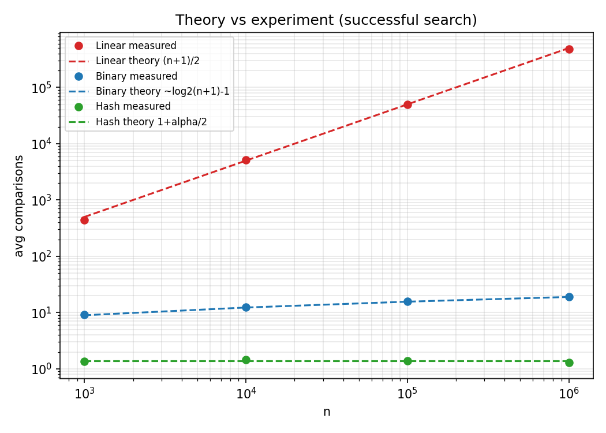
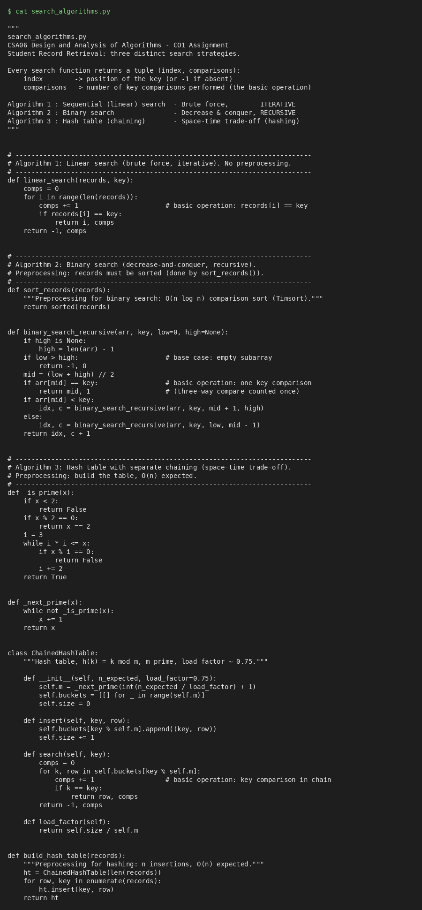
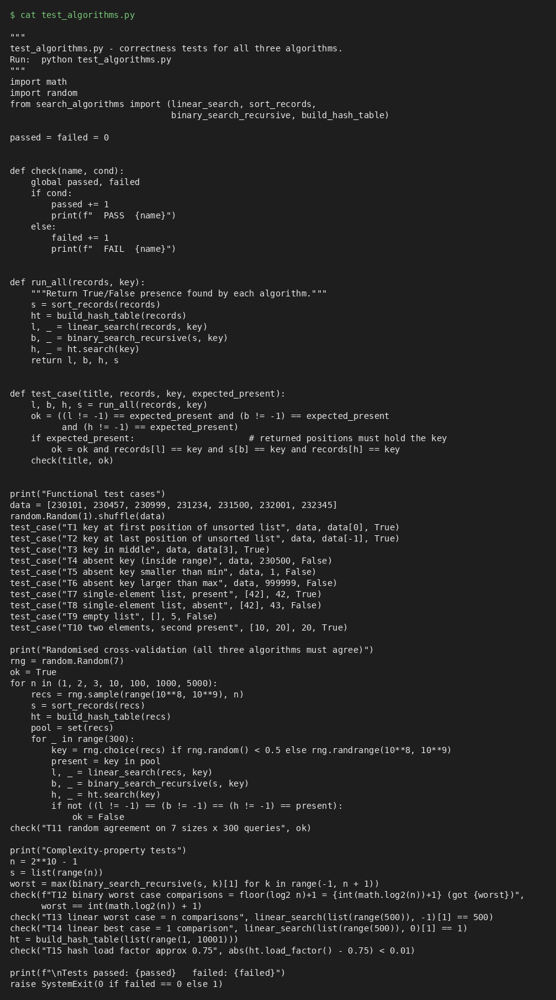
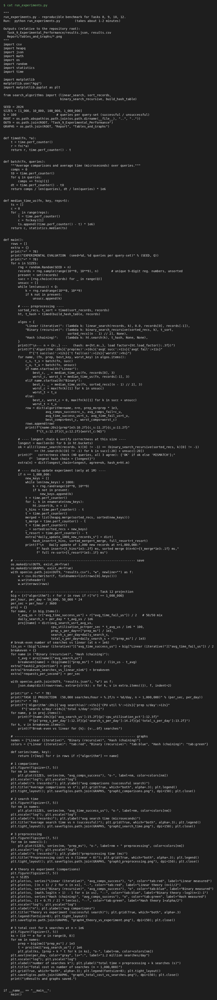
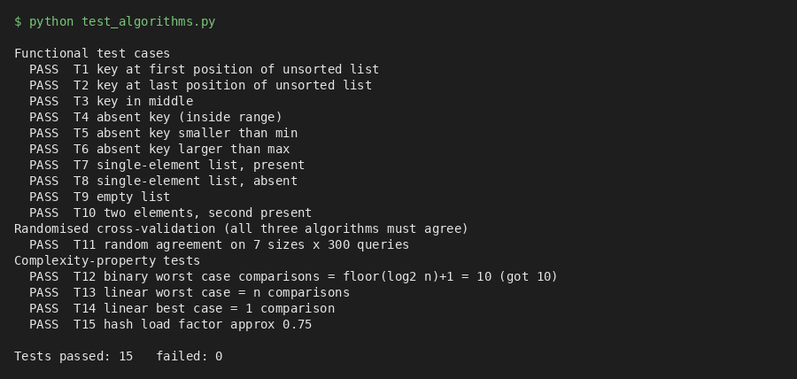
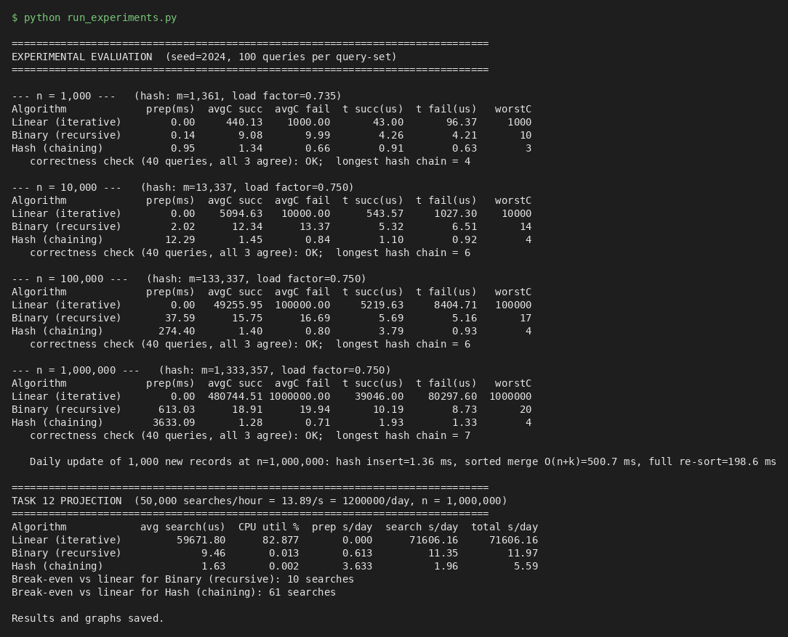

# CSA06 Design and Analysis of Algorithms – Assignment 1 (CO1)
## Design, Analyse and Validate an Efficient Search Strategy for a Large-Scale Student Record System
**Student:** JAYASHREE S · **Department:** Computer Science and Engineering, SIMATS Engineering
**Repository:** https://github.com/shree12042007/CSA0607-DAA

---

# Task 1 – Design the Algorithm (5 Marks)

**Problem.** Given a collection of *n* student records, each with a unique registration number, decide whether a key *K* exists and return its position.
**Input size:** *n* = number of records (10³ → 10⁶+).

Three algorithms with *different design strategies* were chosen. The iterative/recursive requirement is met by Algorithm 1 (iterative) and Algorithm 2 (recursive). Algorithm 2 is **not** an iterative/recursive twin of Algorithm 1 – it uses a different strategy and a different data organisation.

| # | Algorithm | Design strategy | Style | Preprocessing |
|---|-----------|-----------------|-------|---------------|
| 1 | Sequential (linear) search | Brute force | Iterative | None |
| 2 | Binary search | Decrease-and-conquer (decrease by half) + presorting (transform-and-conquer) | Recursive | Sort the records, Θ(n log n) |
| 3 | Hash table with chaining | Space–time trade-off (hashing / input enhancement) | Iterative (inside chain) | Build table, Θ(n) expected |

---
## Algorithm 1 – Linear Search (Brute Force, Iterative)

**Basic idea.** Examine records one by one from the start until the key is found or the list ends. It makes no assumption about the order of the data.

```
ALGORITHM LinearSearch(A[0..n-1], K)
  for i ← 0 to n-1 do
      if A[i] = K then return i        // key comparison
  return -1
```
**Preprocessing:** none – works directly on the unsorted database.
**Why investigated:** It is the natural baseline; it is the only option if a record is looked up once and the data are unordered, and it has zero setup cost and zero extra memory. All other algorithms must be compared against it.

---
## Algorithm 2 – Binary Search (Decrease-and-Conquer, Recursive)

**Basic idea.** If the records are sorted by registration number, compare K with the middle record. If equal, done; if K is smaller, the key can only be in the left half; otherwise only in the right half. Each comparison discards half of the remaining records.

```
ALGORITHM Preprocess(A[0..n-1])
  sort A in ascending order            // e.g. merge sort / Timsort, Θ(n log n)

ALGORITHM BinarySearch(A, K, low, high)
  if low > high then return -1         // base case: empty range
  mid ← ⌊(low + high) / 2⌋
  if A[mid] = K then return mid        // key comparison
  else if K < A[mid] then return BinarySearch(A, K, low, mid-1)
  else                    return BinarySearch(A, K, mid+1, high)
```
**Preprocessing:** the records (or an index of registration numbers + record pointers) must be sorted once.
**Why investigated:** it is the textbook example of decrease-and-conquer; it turns a Θ(n) problem into Θ(log n) at the cost of a one-time sort, so it tests whether presorting pays off. It is also naturally recursive, giving a recurrence relation to analyse (Tasks 6–7).

---
## Algorithm 3 – Hash Table with Separate Chaining (Space–Time Trade-off)

**Basic idea.** Use the registration number to compute the address of the record directly: h(K) = K mod m (m prime, m ≈ n/0.75). Records whose keys collide are kept in a short linked list (chain) at that bucket. A search computes h(K) and scans only that one chain.

```
ALGORITHM BuildHash(A[0..n-1])
  m ← smallest prime ≥ n / 0.75
  create m empty chains T[0..m-1]
  for i ← 0 to n-1 do
      append (A[i], i) to chain T[A[i] mod m]      // O(1)

ALGORITHM HashSearch(T, K)
  for each (key, row) in chain T[K mod m] do
      if key = K then return row                   // key comparison
  return -1
```
**Preprocessing:** build the table once, Θ(n) expected, extra memory Θ(n).
**Why investigated:** it trades memory for time and is the only strategy of the three that can reach Θ(1) average lookups; it represents the standard "database index" idea for exact-match queries and has cheap incremental insertion – relevant to the Day-4 challenge.

---
**Selection summary.** The three strategies sit at three points of the design space: *no preprocessing / slow search* (brute force), *Θ(n log n) preprocessing / logarithmic search* (presorting), and *Θ(n) preprocessing + extra memory / constant average search* (hashing). Source code: `Task_8_Implementation_Testing/Source_Code/search_algorithms.py`.


---

# Task 2 – Identify the Basic Operation (2 Marks)

In all three algorithms the **basic operation is the comparison of the search key K with a stored registration number** (`A[i] = K`, `A[mid] = K`, `key = K`). It is the operation that appears in the innermost loop / recursive step; everything else (index increments, `mid` computation, returning) is executed at most as many times as the comparison.

| Algorithm | Where it occurs | How its count changes with n |
|-----------|-----------------|------------------------------|
| Linear search | the `if A[i] = K` test inside the `for` loop | Executed once for every record examined. If the key is at position p it runs p times; if absent it runs n times. So the count grows **proportionally to n** – a 10× larger database costs about 10× more comparisons. |
| Binary search | the `if A[mid] = K` test at the top of each recursive call | Each call halves the range, so the number of calls (= comparisons) is about log₂ n. A 1000× larger database (10³→10⁶) adds only ~10 more comparisons. |
| Hash search | the `if key = K` test while scanning the single chain `T[K mod m]` | Only the chain length matters. With load factor α = n/m ≈ 0.75 the expected chain length is constant, **independent of n**. |

**Why this operation is appropriate.**
1. It is executed in the innermost repeated part, so it dominates running time as n grows (loop bookkeeping is proportional to it).
2. Each comparison of two 9-digit integers takes a roughly constant time, so *count of comparisons* is directly proportional to running time. This makes the count machine-independent, which is why the experiments (Task 9) record comparisons as well as seconds.
3. It is the only operation shared by all three algorithms, so it allows a fair comparison.

**Cost outside the search – preprocessing.** For algorithms 2 and 3 the preprocessing has its own basic operations: the *key comparison inside the sort* (Θ(n log n) comparisons) for binary search, and the *insertion/hash computation* (n of them) for hashing. These are included in Task 3 so the total cost is not understated.


---

# Task 3 – Derive the Time-Complexity Function Mathematically (6 Marks)

**Input size:** n = number of student records. **Basic operation:** key comparison, C(n) = number of times it runs. Keys are distinct.

---
## 3.1 Linear search

*Worst case.* Key in last position or absent: the loop runs for i = 0…n−1, one comparison per iteration:

C_worst(n) = Σ_{i=0}^{n−1} 1 = **n**

*Best case.* Key at position 0: C_best(n) = **1**.

*Average case – successful search.* Assume the key is equally likely to be at any of the n positions (probability 1/n each). Finding the key at position i (1-indexed) costs i comparisons:

C_avg(n) = (1/n) Σ_{i=1}^{n} i = (1/n) · n(n+1)/2 = **(n+1)/2**

*Average with success probability p* (0 ≤ p ≤ 1; with probability 1−p the key is absent and costs n):

C_avg(n) = p·(n+1)/2 + (1−p)·n

*Preprocessing:* none, P(n) = 0.
*Total for k searches:* T_lin(n, k) = k · (n+1)/2 (successful) … k·n (unsuccessful) ⇒ **Θ(k·n)**.

*Check against data (n = 1,000,000):* theory (n+1)/2 = 500,000.5; measured 480,744 (100 random successful queries; the sampling standard deviation is ≈ n/√(12·100) ≈ 28,900, so the result is within one standard deviation). Unsuccessful: theory 1,000,000, measured 1,000,000.

---
## 3.2 Binary search (recursive) with sorting

### Search cost
Each call performs one comparison and recurses on at most ⌊n/2⌋ records (derivation in Task 6–7), giving C(n) = C(⌊n/2⌋) + 1, C(1) = 1 ⇒

C_worst(n) = **⌊log₂ n⌋ + 1**

*Average case (successful).* Take n = 2^k − 1 so that the comparison tree is a perfect binary tree of k levels. Level i (i = 1..k) holds 2^(i−1) records, each found after i comparisons:

C_avg(n) = (1/n) Σ_{i=1}^{k} i·2^(i−1) = ((k−1)·2^k + 1) / (2^k − 1) ≈ k − 1 + k/n

so **C_avg(n) ≈ log₂(n+1) − 1** (about one comparison less than the worst case).
For n = 10⁶: log₂(10⁶+1) − 1 = 18.93; measured 18.91.

### Preprocessing cost (sorting)
Any comparison sort needs at least log₂(n!) ≈ n log₂ n − 1.44 n comparisons, and merge sort achieves it: its recurrence S(n) = 2S(n/2) + (n−1) gives S(n) ≈ n log₂ n − n + 1.
Therefore **P(n) = Θ(n log n)**. (Our implementation uses Python's `sorted`, a Timsort, which is Θ(n log n) worst-case.)

### Total cost for k searches
T_bin(n, k) = P(n) + k · C(n) = **n log₂ n + k log₂ n = (n + k) log₂ n**, i.e. Θ((n + k) log n).

---
## 3.3 Hash table with separate chaining

Let m = number of buckets, load factor α = n/m (≈ 0.75 here). Assume simple uniform hashing: every key is equally likely to go to any of the m buckets.

### Preprocessing
Building: n insertions, each = one modulus + one append = O(1) ⇒ **P(n) = Θ(n)** (expected, and also worst case for appending at chain tail with a stored tail pointer / list append). Extra space Θ(n + m).

### Unsuccessful search
The whole chain is scanned. Expected chain length = n/m = α, so
**C_fail = α = 0.75** comparisons. (Measured: 0.66, 0.84, 0.80, 0.71.)

### Successful search
Consider the key that was the i-th to be inserted. The comparisons needed = 1 + (number of keys inserted *before* it that fall in the same chain). Each of the i−1 earlier keys lands in this chain with probability 1/m:

E[C | key i] = 1 + (i−1)/m

Averaging over i = 1..n:

C_avg = (1/n) Σ_{i=1}^{n} (1 + (i−1)/m) = 1 + (n−1)/(2m) = **1 + α/2 − α/(2n) ≈ 1 + α/2 = 1.375**

(measured: 1.34, 1.45, 1.40, 1.28). This does not depend on n ⇒ **O(1)** average.

### Worst case
If all n keys fall into the same chain (degenerate hash function): C_worst = n.

### Total cost for k searches
T_hash(n, k) = n + k·(1 + α/2) = **Θ(n + k)** expected.

---
## 3.4 Overall cost summary (preprocessing + searching)

| Algorithm | Preprocessing | One search (avg) | k searches in total |
|-----------|---------------|------------------|---------------------|
| Linear | 0 | (n+1)/2 | k(n+1)/2 → Θ(kn) |
| Binary | ≈ n log₂ n | ≈ log₂ n − 1 | n log₂ n + k log₂ n → Θ((n+k) log n) |
| Hash | ≈ n (insertions) | ≈ 1 + α/2 | n + 1.375k → Θ(n + k) |

**Break-even (in comparisons).** Binary search beats linear search when n log₂ n + k log₂ n < k n/2, i.e. k > n log₂ n / (n/2 − log₂ n) ≈ 2 log₂ n. For n = 10⁶ that is only k ≈ 40 searches in the comparison-count model (measured in time: 10 searches). Hashing beats linear when n + 1.375k < kn/2, i.e. k ≳ 2 – 3 searches in the count model (the measured time break-even is larger, 61 searches, because inserting into a hash table costs more *time* per element than a comparison – see Task 10).


---

# Task 4 – Best, Average and Worst-Case Behaviour (4 Marks)

## 4.1 Linear search
| Case | Input condition | Operations | Why |
|------|-----------------|-----------|-----|
| **Best** | The requested registration number is the **first** record in the file | 1 comparison | The loop exits at the first iteration. |
| **Average** | Key present and equally likely at any position (or present with probability p) | (n+1)/2 for success; p(n+1)/2 + (1−p)n in general | On average half of the list is scanned before the key is hit. |
| **Worst** | Key is the **last** record, or **not in the database** | n comparisons | No early exit is possible; every record must be examined to prove absence. |

*Observation:* the worst case is not rare – every failed lookup (e.g. a typo in a registration number) is a worst case. Measured at n = 10⁶: successful ≈ 4.8×10⁵ comparisons, unsuccessful = 10⁶.

## 4.2 Binary search
| Case | Input condition | Operations | Why |
|------|-----------------|-----------|-----|
| **Best** | Key is exactly the **middle** element of the sorted array | 1 comparison | Found in the first call. |
| **Average** | Key present, each position equally likely | ≈ log₂(n+1) − 1 | About half of the keys lie in the bottom level of the decision tree, which has the largest depth, so the average is only ≈1 below the worst. |
| **Worst** | Key absent, or located at the deepest level of the decision tree | ⌊log₂ n⌋ + 1 | The range must be halved until it is empty/one element. |

*Observation:* binary search has little spread – best 1, average ≈ 19, worst 20 for n = 10⁶. Important precondition: the array must remain sorted; otherwise results are wrong.

## 4.3 Hash table (chaining)
| Case | Input condition | Operations | Why |
|------|-----------------|-----------|-----|
| **Best** | Bucket is empty (unsuccessful search, 0 comparisons) or the key is first in its chain (1 comparison) | 0–1 | The hash directly points to the answer. |
| **Average** | Keys spread uniformly, load factor α | successful 1 + α/2 ≈ 1.375; unsuccessful α = 0.75 | Chain length is Poisson-like with mean α; independent of n. |
| **Worst** | All keys collide into one bucket (poor hash function, e.g. m sharing factors with a pattern in the registration numbers, or an adversarial key set) | n comparisons | The table degenerates into a linked list = linear search. |

*Observation:* the largest chain observed in the experiments was 4, 6, 6 and 7 for n = 10³…10⁶ – the worst case is theoretical for a well-chosen prime modulus (and can be avoided with a universal hash function).


---

# Task 5 – Asymptotic Analysis (3 Marks)

## 5.1 Notation for each algorithm

| Algorithm | Best case | Average case | Worst case | Preprocessing |
|-----------|-----------|--------------|-----------|---------------|
| Linear | Θ(1) | Θ(n) | Θ(n) | none |
| Binary (recursive) | Θ(1) | Θ(log n) | Θ(log n) | Θ(n log n) |
| Hash (chaining) | Θ(1) | Θ(1) expected | Θ(n) | Θ(n) |

**Justification with definitions.**
* Linear, average: (n+1)/2 ≥ n/2 for all n ≥ 1 and (n+1)/2 ≤ n for n ≥ 1, so with c₁ = 1/2, c₂ = 1 and n₀ = 1 we get c₁n ≤ (n+1)/2 ≤ c₂n ⇒ **Θ(n)**. The search function as a whole is **O(n)** and also **Ω(1)** (it always does ≥ 1 comparison), so no single Θ describes *all* inputs – hence the case split.
* Binary: ⌊log₂ n⌋ + 1 ≥ (1/1)·log₂ n for n ≥ 2 and ≤ 2 log₂ n for n ≥ 2 ⇒ **Θ(log n)**; the best case, key in the middle, is Θ(1), so search is O(log n) and Ω(1).
* Hash: 1 + α/2 is a constant (α is held at ≈ 0.75 by choosing m) ⇒ Θ(1) expected; worst case n ⇒ O(n).
* Sorting: Ω(n log n) by the decision-tree lower bound for comparison sorts and O(n log n) by merge sort ⇒ Θ(n log n).

**Order of growth:**  1 ≺ log n ≺ n  (hash ≺ binary ≺ linear for the search step); for the *preprocessing* step: n ≺ n log n.

## 5.2 Behaviour when n becomes very large and the meaning for the university

| n | Linear (avg. comparisons) | Binary (worst) | Hash (avg.) |
|---|---------------------------|----------------|-------------|
| 1,000 | ≈ 500 | 10 | ≈ 1.4 |
| 10,000 | ≈ 5,000 | 14 | ≈ 1.4 |
| 100,000 | ≈ 50,000 | 17 | ≈ 1.4 |
| 1,000,000 | ≈ 500,000 | 20 | ≈ 1.4 |

* Going from 10³ to 10⁶ records (×1000): linear search does **1000× more work**, binary search only **2× more** (10 → 20 comparisons), and hash search **the same** amount.
* A linear search over 10⁶ records performs half a million comparisons per request; a binary search does 20 – a reduction of ~25,000×. Hence linear search is acceptable for a 1,000-record department list but impractical as the university scales to millions of records.
* Because the growth rates are different *orders* (n vs log n vs 1), the constant factors (e.g. the per-comparison speed) cannot rescue the linear algorithm: a computer 100× faster merely postpones the problem by 100× in n.
* The preprocessing is also asymptotically meaningful: sorting grows as n log n, so it is **superlinear**, and a hash build is **linear**. Both are one-time costs which are amortised over the number of searches k. Total growth: linear Θ(kn), binary Θ((n+k) log n), hash Θ(n+k). When k is large (the Day-4 scenario: 1.2 million searches per day) the preprocessing terms become negligible compared with the Θ(kn) term of linear search.


---

# Task 6 – Formulate the Recurrence Relation (3 Marks)

The recursive algorithm is the **recursive binary search** (Algorithm 2):

```
BinarySearch(A, K, low, high)
  if low > high then return -1                  // (1) base case
  mid ← ⌊(low + high)/2⌋                        // (2) O(1) work
  if A[mid] = K then return mid                 // (3) 1 comparison
  else if K < A[mid] then return BinarySearch(A, K, low, mid-1)   // (4a) left call
  else return BinarySearch(A, K, mid+1, high)                    // (4b) right call
```

Let T(n) = number of key comparisons when the current range `A[low..high]` contains n = high − low + 1 records.

| Component | Identified from the algorithm |
|-----------|-------------------------------|
| **Input size of original problem** | n = high − low + 1, the number of records still under consideration (initially all n records). |
| **Size of the sub-problem** | The left call receives `low..mid-1`: ⌊(n−1)/2⌋ = ⌈n/2⌉ − 1 records. The right call receives `mid+1..high`: ⌊n/2⌋ records. In the worst case it is ⌊n/2⌋ (the larger half). |
| **Number of recursive calls** | **One.** Lines (4a) and (4b) are mutually exclusive (if/else); only one half is searched, the other is discarded. (This is why it is a *decrease*-and-conquer, not a *divide*-and-conquer, algorithm: a = 1, not 2.) |
| **Work outside the recursive call** | Computing `mid`, one comparison `A[mid] = K` (and the `K < A[mid]` decision, counted as the same three-way comparison) ⇒ constant, f(n) = 1. |
| **Base case** | n = 0 (`low > high`): returns immediately with 0 comparisons ⇒ T(0) = 0. (And therefore T(1) = T(0) + 1 = 1: one record needs one comparison.) |

**Putting the pieces together.**  
T(n) = (work outside the call) + (number of calls) × T(size of the subproblem)

> **T(n) = T(⌊n/2⌋) + 1  for n ≥ 1,    T(0) = 0**

for the worst case (key absent or always going to the larger half).  
In asymptotic form, T(n) = T(n/2) + Θ(1), i.e. a = 1, b = 2, f(n) = Θ(1).

*Check with the code:* `binary_search_recursive` returns `idx, c + 1` after the recursive call, i.e. it adds exactly 1 comparison to the result of one smaller call – the same structure as the recurrence.

*Why the best case does not follow this recurrence:* if the key is at `mid`, the algorithm stops before recursing; T_best(n) = 1 – a non-recursive case already covered in Task 4.


---

# Task 7 – Solve the Recurrence Relation (4 Marks)

Recurrence from Task 6:  **T(n) = T(⌊n/2⌋) + 1, n ≥ 1; T(0) = 0** (so T(1) = 1).

## Method 1 – Backward substitution (iteration method)
**Why applicable:** the recurrence has a single recursive term with a simple shrinking argument, so repeated expansion shows a clear pattern. Take n = 2^k (the floors disappear) – the general case follows in Method 2.

T(n) = T(n/2) + 1
     = [T(n/4) + 1] + 1 = T(n/4) + 2
     = [T(n/8) + 1] + 2 = T(n/8) + 3
     …
     = T(n/2^i) + i

The expansion stops when n/2^i = 1, i.e. i = log₂ n. Then

T(n) = T(1) + log₂ n = 1 + log₂ n,

so **T(n) = log₂ n + 1 = Θ(log n)**.

## Method 2 – Substitution method (induction) – exact result for all n
**Claim:** T(n) = ⌊log₂ n⌋ + 1 for all n ≥ 1.
* *Base:* n = 1 ⇒ T(1) = 1 = ⌊log₂ 1⌋ + 1 ✓.
* *Inductive step:* assume the claim for all values < n, n ≥ 2. Then
  T(n) = T(⌊n/2⌋) + 1 = (⌊log₂ ⌊n/2⌋⌋ + 1) + 1.
  For n ≥ 2, ⌊log₂ ⌊n/2⌋⌋ = ⌊log₂ n⌋ − 1, so
  T(n) = (⌊log₂ n⌋ − 1 + 1) + 1 = ⌊log₂ n⌋ + 1 ✓. ∎

## Method 3 – Master Theorem
**Why applicable:** the recurrence has the form T(n) = a·T(n/b) + f(n) with a = 1 ≥ 1, b = 2 > 1 and f(n) = Θ(1) a polynomially bounded positive function.

* a = 1, b = 2 ⇒ n^(log_b a) = n^(log₂ 1) = n⁰ = 1.
* f(n) = Θ(1) = Θ(n^(log_b a)) ⇒ **Case 2** (f(n) = Θ(n^(log_b a) · log⁰ n)).
* Therefore T(n) = Θ(n^(log_b a) · log n) = **Θ(log n)**.

All three methods agree.

## Interpretation
* The recursion depth, and therefore the number of comparisons, grows **logarithmically**: doubling the database adds exactly **one** extra comparison.
* n = 1,000 → ≤ 10; n = 10⁶ → ≤ 20 (measured worst case: 10 and 20 – exact match with ⌊log₂ n⌋ + 1).
* The recursion depth equals the number of comparisons (≤ 20 for a million records), so the call stack is small (Θ(log n) space) and there is no risk of stack overflow.

## Supplementary – the preprocessing recurrence (merge sort)
Sorting for binary search by merge sort: S(n) = 2S(n/2) + Θ(n), S(1) = 0. Master Theorem: a = 2, b = 2 ⇒ n^(log₂ 2) = n and f(n) = Θ(n) ⇒ Case 2 ⇒ **S(n) = Θ(n log n)**. This confirms the preprocessing cost used in Task 3.


---

# Task 8 – Implement and Test the Algorithms (4 Marks)

## Implementation
Language: Python 3 (standard library + `matplotlib`, `Pillow` only for graphs/screenshots).

| File (in `Source_Code/`) | Purpose |
|--------------------------|---------|
| `search_algorithms.py` | The three algorithms: `linear_search` (iterative), `binary_search_recursive` + `sort_records`, `ChainedHashTable` + `build_hash_table`. Every search returns `(index, comparisons)` so that the basic operation can be counted exactly, exactly as analysed in Tasks 2–3. |
| `test_algorithms.py` | 15 correctness / property tests. |
| `run_experiments.py` | Benchmark for n = 1,000; 10,000; 100,000; 1,000,000. Writes `results.csv/json` and the graphs. |
| `make_screenshots.py` | Renders source code and console outputs to PNG for the report. |

The implementation matches the analysed pseudocode one-to-one (one comparison counted per loop iteration / per recursive call / per chain element).

## Reproducible testing procedure
1. **Dataset.** For each n a list of n *unique* 9-digit registration numbers (100,000,000–999,999,999) is drawn with `random.Random(2024 + n).sample`, in random (unsorted) order. All three algorithms receive exactly the same records (linear: the raw list; binary: the sorted copy; hash: the table built from the same list). Fixed seeds make the run repeatable.
2. **Query sets.** 100 random *existing* keys (successful search) and 100 random *non-existing* keys (unsuccessful search). Identical query sets for all three algorithms. In addition: best-case key (first element for linear, middle element for binary), and worst-case key (last element for linear).
3. **Measurements.** Average number of comparisons, average time per search (µs, `time.perf_counter`), preprocessing time (ms), worst comparisons seen, longest hash chain.
4. **Consistency.** Same machine, same process, same Python interpreter, no other deliberate load; sorting and hashing time are included in the preprocessing column rather than hidden.
5. **Correctness check at every size:** 40 queries (20 present, 20 absent) must give the same found/not-found result in all three algorithms – all sizes reported *OK*.

## Test cases (`test_algorithms.py`)
| ID | Case | Expected |
|----|------|----------|
| T1 | key = first element of unsorted list | found by all |
| T2 | key = last element | found |
| T3 | key in the middle | found |
| T4 | absent key inside the value range | not found |
| T5 | absent key smaller than minimum | not found |
| T6 | absent key larger than maximum | not found |
| T7/T8 | single-element list (present / absent) | found / not found |
| T9 | empty list | not found, no crash |
| T10 | two-element list, second present | found |
| T11 | 7 sizes × 300 random queries – all three must agree with Python `in` | agree |
| T12 | binary worst case on n = 1023 | = ⌊log₂ n⌋+1 = 10 |
| T13/T14 | linear worst / best case counts | n / 1 |
| T15 | hash load factor | ≈ 0.75 |

**Result: 15 passed, 0 failed** (`Report/Output_Screenshots/test_output.png`).

## How to run
```
cd Task_8_Implementation_Testing/Source_Code
pip install matplotlib pillow
python test_algorithms.py
python run_experiments.py        # ≈ 1–2 minutes; writes results + graphs
python make_screenshots.py
```


---

# Task 9 – Record Experimental Performance (3 Marks)

Raw data: `results.csv` / `results.json` (generated by `Source_Code/run_experiments.py`, seed 2024, 100 successful + 100 unsuccessful queries per size, identical for every algorithm).

## Table 1 – Average comparisons, successful search

| n | Linear | Binary | Hash |
|---|---|---|---|
| 1,000 | 440.13 | 9.08 | 1.34 |
| 10,000 | 5,094.63 | 12.34 | 1.45 |
| 100,000 | 49,255.95 | 15.75 | 1.40 |
| 1,000,000 | 480,744.51 | 18.91 | 1.28 |

## Table 2 – Average comparisons, unsuccessful search

| n | Linear | Binary | Hash |
|---|---|---|---|
| 1,000 | 1,000.00 | 9.99 | 0.66 |
| 10,000 | 10,000.00 | 13.37 | 0.84 |
| 100,000 | 100,000.00 | 16.69 | 0.80 |
| 1,000,000 | 1,000,000.00 | 19.94 | 0.71 |

## Table 3 – Worst-case comparisons observed

| n | Linear | Binary | Hash |
|---|---|---|---|
| 1,000 | 1,000 | 10 | 3 |
| 10,000 | 10,000 | 14 | 4 |
| 100,000 | 100,000 | 17 | 4 |
| 1,000,000 | 1,000,000 | 20 | 4 |

## Table 4 – Average search time, successful (µs)

| n | Linear | Binary | Hash |
|---|---|---|---|
| 1,000 | 43.00 | 4.26 | 0.91 |
| 10,000 | 543.57 | 5.32 | 1.10 |
| 100,000 | 5,219.63 | 5.69 | 3.79 |
| 1,000,000 | 39,046.00 | 10.19 | 1.93 |

## Table 5 – Average search time, unsuccessful (µs)

| n | Linear | Binary | Hash |
|---|---|---|---|
| 1,000 | 96.37 | 4.21 | 0.63 |
| 10,000 | 1,027.30 | 6.51 | 0.92 |
| 100,000 | 8,404.71 | 5.16 | 0.93 |
| 1,000,000 | 80,297.60 | 8.73 | 1.33 |

## Table 6 – Preprocessing time (ms)

| n | Linear | Binary | Hash |
|---|---|---|---|
| 1,000 | 0.00 | 0.14 | 0.95 |
| 10,000 | 0.00 | 2.02 | 12.29 |
| 100,000 | 0.00 | 37.59 | 274.40 |
| 1,000,000 | 0.00 | 613.03 | 3,633.09 |

Hash table details: load factor 0.735 / 0.750 / 0.750 / 0.750; longest chain 4 / 6 / 6 / 7 for n = 10³ … 10⁶. All correctness checks: OK.

## Table 7 – Daily update of 1,000 new records at n = 1,000,000

| Method | Time |
|---|---|
| Hash: insert 1,000 records | 1.36 ms |
| Sorted array: merge new records, O(n+k) | 500.7 ms |
| Sorted array: full re-sort | 198.6 ms |

## Graphs


**Reading the graphs (log–log axes).** Linear search is a straight line with slope 1 (Θ(n)); binary search is almost flat (log n); hash is flat (O(1)). The preprocessing curves for sorting and hashing are both a little steeper than slope 1. In Graph 5 (total time for k searches at n = 10⁶) the linear curve starts lowest (no preprocessing) but crosses the binary curve after about 10 searches and the hash curve after about 61 searches; at the Day-4 volume of 1.2 million searches per day the gap is about four orders of magnitude.


---

# Task 10 – Compare Theory with Experimental Behaviour (4 Marks)



## 10.1 Does the observed growth agree with the derived complexity? – comparison counts

| n | Linear theory (n+1)/2 | Linear measured | Binary theory log₂(n+1)−1 | Binary measured | Hash theory 1+α/2 | Hash measured |
|---|---|---|---|---|---|---|
| 1,000 | 500.5 | 440.1 | 8.97 | 9.08 | 1.375 | 1.34 |
| 10,000 | 5,000.5 | 5,094.6 | 12.29 | 12.34 | 1.375 | 1.45 |
| 100,000 | 50,000.5 | 49,256.0 | 15.61 | 15.75 | 1.375 | 1.40 |
| 1,000,000 | 500,000.5 | 480,744.5 | 18.93 | 18.91 | 1.375 | 1.28 |

* **Linear:** comparisons grow ×11.6 → ×9.7 → ×9.8 per decade of n, i.e. ≈ ×10 = linear growth. Deviations (−12 % … +2 %) come from using only 100 random queries (standard error ≈ 5.8 % of n/2 – larger at small samples); the unsuccessful search matches the theory exactly (n).
* **Binary:** matches log₂(n+1) − 1 to within 0.15 comparisons; every decade adds ≈ 3.3 comparisons (= log₂ 10), exactly as Θ(log n) predicts; the worst values 10, 14, 17, 20 equal ⌊log₂ n⌋ + 1 exactly – this validates the recurrence solution of Task 7.
* **Hash:** the number of comparisons is flat at ≈ 1.3–1.45 (successful) and ≈ 0.7–0.8 (unsuccessful), matching 1 + α/2 and α; the longest chains (4, 6, 6, 7) confirm that the worst-case Θ(n) does not occur with a prime modulus.

## 10.2 Execution time
| n | Linear (µs/search, succ.) | Binary | Hash | Sort prep (ms) | Hash build (ms) |
|---|---|---|---|---|---|
| 1,000 | 43.0 | 4.26 | 0.91 | 0.14 | 0.95 |
| 10,000 | 543.6 | 5.32 | 1.10 | 2.02 | 12.29 |
| 100,000 | 5,219.6 | 5.69 | 3.79 | 37.59 | 274.40 |
| 1,000,000 | 39,046 | 10.19 | 1.93 | 613.03 | 3,633.09 |

* Linear: time per comparison is ≈ 0.08–0.11 µs at every size, so time ∝ comparisons ∝ n: **theory and experiment agree closely** (×908 in time for ×1000 in n).
* Binary: time grows only ×2.4 for ×1000 in n – consistent with the doubling of comparisons (10 → 20).
* Hash: ≈ constant (0.9 – 3.8 µs, ×2.1 overall).

## 10.3 Where theory and experiment differ, and why
1. **Hash and binary times rise slightly although the theory says "constant"/"log".** At n = 10⁶ the data occupy tens of MB; accesses are random, so CPU-cache misses make each comparison slower than at n = 10³. The big-O model counts comparisons, not memory latency. The 100,000-record hash timing (3.79 µs) is also noisier than neighbouring sizes; timing at the µs scale is affected by garbage collection/OS scheduling – we did not repeat the full run multiple times, so small timing differences between sizes should not be over-interpreted.
2. **Preprocessing grows faster than theory.** Sorting grew ×4,300 for a ×1000 increase in n (n log n predicts ≈ ×2,000) and the hash build ×3,800 (Θ(n) predicts ×1000). The likely causes are cache/memory-allocation effects and Python's garbage collector while creating 1.3 million list objects and 1 million tuples (we did not profile to confirm).
3. **Hash build is *slower* than sorting here although Θ(n) < Θ(n log n).** `sorted()` is implemented in C, whereas our hash-table build is an interpreted Python loop; the constant factor of the implementation (≈ 6×) outweighs the log n factor (≈ 20) at n = 10⁶. This is a property of our implementation language, not of the algorithms; in a compiled implementation the hash build would be expected to be faster, but this was not tested.
4. **Counted vs measured:** the timing runs include the cost of the comparison counter itself (the same overhead for all three algorithms), so absolute times are somewhat inflated, but relative growth is unaffected.

## 10.4 Which algorithm scales best?
Search step: **Hash ≻ Binary ≻ Linear**. Between 10³ and 10⁶ records, linear search becomes ≈ 900× slower while binary becomes ≈ 2.4× slower and hash ≈ 2×. Including preprocessing, binary search pays off after only ≈ 10 searches and hashing after ≈ 61 searches at n = 10⁶ (Task 9/12), so both preprocessing investments are recovered very quickly in any system with repeated lookups.


---

# Task 11 – Recommend and Defend the Final Design (4 Marks)

## Recommendation (original problem, before the Day-4 change)
**Sort the registration numbers once and use binary search (recursive/iterative) on the sorted index.**

## Why this and not the alternatives
| Criterion | Linear | **Binary + sort** | Hash |
|-----------|--------|-------------------|------|
| Search cost (n = 10⁶, measured) | 0.5 million comparisons, 39–80 ms | **≈ 19–20 comparisons, ≈ 9–10 µs** | ≈ 1.3 comparisons, ≈ 1.6–1.9 µs |
| Preprocessing (n = 10⁶, measured) | none | **0.61 s** | 3.63 s |
| Break-even vs linear | – | **≈ 10 searches** | ≈ 61 searches |
| Worst-case guarantee | Θ(n) | **Θ(log n), always** | Θ(n) (theoretical; observed longest chain 7) |
| Extra memory | none | **none (sorted copy/ index only)** | Θ(n) buckets + chains |
| Supports ordered/range queries ("all students 230100–230199", "next registration number") | no | **yes** | no |
| Supports updates | trivial | needs re-sort / merge | trivial |

* **Theoretical efficiency:** Θ(n log n) preprocessing + Θ(log n) per search, i.e. Θ((n + k) log n) for k searches.
* **Experimental performance:** for n = 10³ → 10⁶ the average search comparisons rose from 9 to 19 (theory 8.97 → 18.93) and the search time from 4.3 to 10.2 µs, whereas linear search rose from 43 µs to 39 ms.
* **Preprocessing cost:** 0.14 ms (10³) … 0.61 s (10⁶); recovered after ≈ 10 searches at n = 10⁶.
* **Why not simply "lowest Big-O"?** Hashing has the lowest search complexity, but in our measurements it had the largest preprocessing cost (3.6 s at 10⁶), needs extra memory, gives no ordered access and has a Θ(n) worst case. Without information about how many searches will be made, binary search is the most balanced choice: tiny preprocessing, a hard logarithmic worst-case bound, no extra memory, and the sorted order is useful for administration (listing, ranges). Linear search is only justified for a one-off lookup on unsorted data (fewer than ≈ 10 searches).
* **Trade-offs / limitations:** (i) the sorted order must be maintained when records are added (re-sort or merge, Θ(n) – 0.2–0.5 s for a day's update at n = 10⁶ in our test); (ii) it is slower than hashing per search by a constant ≈ 5×; (iii) the result applies to in-memory data – for disk-resident data a B-tree variant of the same idea would be used.
* **Practical as the database grows?** Yes: 10³ → 10⁶ (×1000) costs only 10 extra comparisons; 10⁹ records would need ≈ 30 comparisons.


---

# Task 12 – Day-4 Design Challenge: Re-evaluate and Adapt the Design (8 Marks)

**New requirement:** 50,000 searches per hour on 1,000,000 records; new records only once per day.
Load: 50,000 / 3,600 ≈ **13.9 searches per second**, i.e. **1.2 million searches per day**.
Measured figures used below come from `Task_9_Experimental_Performance/results.json` (n = 10⁶, 50 % successful / 50 % unsuccessful queries; single core).

---
## A. Impact Analysis (2 marks)

**What changed.** In the original problem we did not know how often searches happen, so preprocessing and searching were judged together on a "few lookups" basis. Now (i) the search volume is known and very large (k = 1.2 × 10⁶ per day), and (ii) the data are essentially **static**: they change once per day.

**Assumptions affected.**
* *"Preprocessing must be cheap relative to the search work"* – no longer true; the preprocessing cost is paid **once per day** and shared by 1.2 million searches. Sorting (0.6 s) or building a hash table (3.6 s) costs 0.5 µs / 3 µs per search when amortised – negligible.
* *"Updates may interleave with searches"* – no longer true; the index can be built offline in an update window and then used read-only, which also means no locking.
* *"Per-search cost is not critical"* – now it is: total search work = k × cost per search.

**Why search frequency matters.** Total cost = P(n) + k·C(n). For linear search this is k·n/2 = 1.2 × 10⁶ × 5 × 10⁵ ≈ **6 × 10¹¹ comparisons/day**; for binary ≈ 2.4 × 10⁷; for hashing ≈ 1.7 × 10⁶ (+ build 10⁶).

**Why the low update frequency helps.** Structures that are expensive to build but fast to query (sorted array, hash table) become attractive, because their build cost is amortised over a full day of queries and does not have to be repeated after every insertion (the weak point of sorted arrays, where each insertion would cost Θ(n)).

---
## B. Evaluation of the Original Design (2 marks)

Original recommendation: sort once + binary search.

* **Expected behaviour at 50,000 searches/hour.** 20 comparisons and ≈ 9.5 µs per search ⇒ 13.9 searches/s use **0.013 %** of one core; ≈ 11.4 s of CPU per day for all searches. The requirement is met with an enormous margin.
* **Is the preprocessing cost acceptable?** Yes: 0.61 s sort (once per day) and 0.2 – 0.5 s to incorporate a day's new records (1,000 records, measured) – both trivial against a 24-hour period.
* **Could another approach give better overall performance?**
  * *Linear search (for reference):* 59.7 ms per search ⇒ **82.9 % of one core is busy just on searching** (≈ 19.9 CPU-hours per day) – no headroom for peaks (queue build-up), slower hardware or concurrency, and the cost grows linearly with database size. **Rejected.**
  * *Hash table:* ≈ 1.6 µs per search (≈ 5.8× faster than binary) and incremental insertion of 1,000 new records in 1.4 ms (vs 200–500 ms to maintain the sorted array). Total daily cost 5.6 s vs 12.0 s. Costs: 3.6 s build, more memory, no ordering, theoretical Θ(n) worst case.

| Daily cost, n = 10⁶, k = 1.2 M (measured, Python) | Avg search | CPU use of one core | Prep/day | Search/day | Total/day |
|---|---|---|---|---|---|
| Linear | 59.7 ms | 82.9 % | 0 | 71,606 s | 71,606 s |
| Binary + sort | 9.46 µs | 0.013 % | 0.61 s | 11.35 s | 11.97 s |
| Hash | 1.63 µs | 0.002 % | 3.63 s | 1.96 s | 5.59 s |

*Honest note:* the original design still *works*; the question is whether a better design exists. It does, but by an absolute margin of seconds per day, not orders of magnitude.

---
## C. Adaptation or Redesign (2 marks)

**Decision: MODIFY.** The original strategy family (preprocess once, then search fast) is kept, but the data structure is changed from a *sorted array + binary search* to a **hash index (chaining, prime m, load factor ≈ 0.75) as the primary exact-match lookup**, rebuilt/updated in the daily update window.

**What changes**
1. Search: `BinarySearch` → `HashSearch` (one hash computation + scan of one short chain).
2. Daily maintenance: instead of re-sorting/merging (Θ(n log n) or Θ(n + k)), the new k records are **inserted in O(k)** (1.4 ms for 1,000); only if α would exceed ≈ 0.75 is the table rebuilt with a larger prime m (Θ(n), once, amortised).
3. Index is read-only during the day ⇒ it can be shared by many search threads without locks; the update runs on a copy and is swapped in atomically.
4. If the administration still needs **ordered/range queries**, keep the sorted array as a secondary index (cost: 0.6 s/day) – hashing cannot answer them.
5. Use a universal/prime-modulus hash (not `K mod 2^j`) so patterns in registration numbers (e.g. year + department prefix) cannot create long chains.

**Effect on complexity**
| | Original | Modified |
|---|---|---|
| Search (average) | Θ(log n) ≈ 19–20 comparisons | **Θ(1)** ≈ 1.375 comparisons |
| Search (worst) | Θ(log n) | Θ(n) theoretical (observed chain ≤ 7) |
| Daily build | Θ(n log n) | Θ(n) (or Θ(k) incremental) |
| Daily update of k new records | Θ(n + k) | **Θ(k)** |
| Space | Θ(n) | Θ(n) with larger constant (m ≈ 1.33 n buckets + chains) |
| k searches per day | Θ((n+k) log n) | **Θ(n + k)** |

---
## D. Evidence-Based Defence (2 marks)

* **Complexity:** total daily cost goes from (n + k) log₂ n ≈ (10⁶ + 1.2×10⁶) × 20 ≈ 4.4 × 10⁷ basic operations to n + 1.375 k ≈ 10⁶ + 1.65 × 10⁶ = 2.7 × 10⁶ – about 16× fewer.
* **Experiment:** measured daily CPU 5.6 s (hash) vs 12.0 s (binary) vs 71,606 s (linear); search latency 1.6 µs vs 9.5 µs vs 59.7 ms; daily update 1.4 ms vs 200–500 ms.
* **Search frequency:** 13.9 searches/s – linear search consumes 83 % of a core (unacceptable, no peak headroom); binary and hash use ≤ 0.013 %.
* **Preprocessing cost:** hash build 3.6 s is paid once per day and is only ≈ 3 µs per search when amortised over 1.2 M searches; break-even against linear search is just ≈ 61 searches.
* **Dataset size:** the advantage of an O(1) structure over O(log n) grows slowly with n (20 → 30 comparisons at 10⁹ records), while linear search keeps growing linearly.
* **Trade-offs:** (a) extra memory (≈ 1.3 M buckets + 1 M entries); (b) no ordering ⇒ keep the sorted index if range queries are needed; (c) theoretical Θ(n) worst case ⇒ prime modulus / universal hashing and load-factor monitoring; (d) the performance gain over binary search is real (≈ 6× per search, ≈ 200× cheaper updates) but small in absolute terms – **if the administration needs ordered queries and does not need the extra speed, retaining the original binary-search design is also technically defensible**; what is *not* defensible is falling back to linear search.
* **Caveat on measurements:** all timings are from one Python run on one machine; the hash build (3.6 s) is slower than the C-implemented `sorted` (0.6 s) partly because of implementation language (see Task 10), so a compiled implementation would shift the build-time comparison in favour of hashing. This was not tested.

**Final decision:** *Modify* – hash index for exact registration-number lookups, built/updated once per day, with the sorted index kept only if ordered queries are required.


---
# Appendix A – Source code and output screenshots
Source: `Task_8_Implementation_Testing/Source_Code/`










