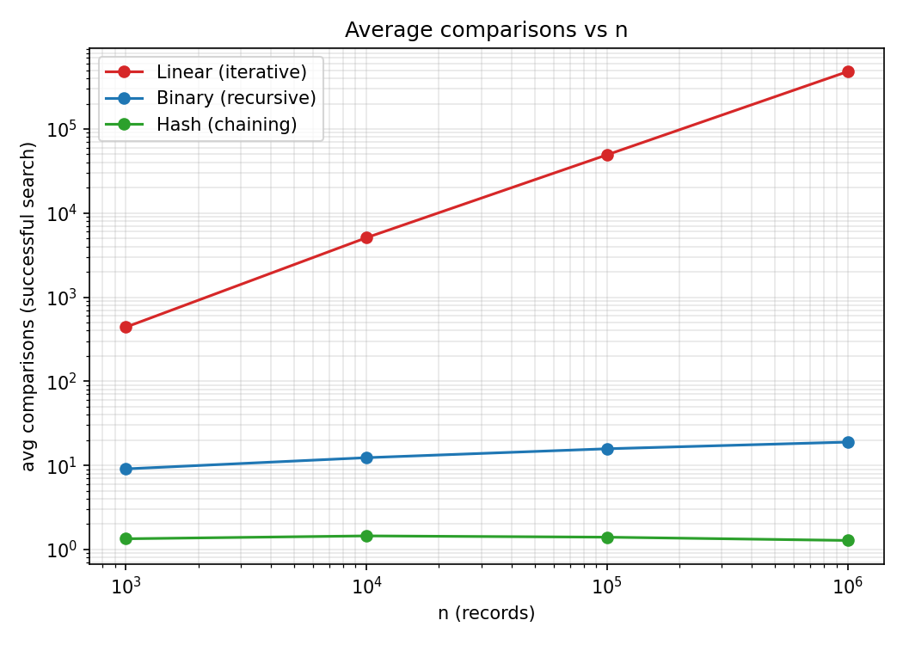
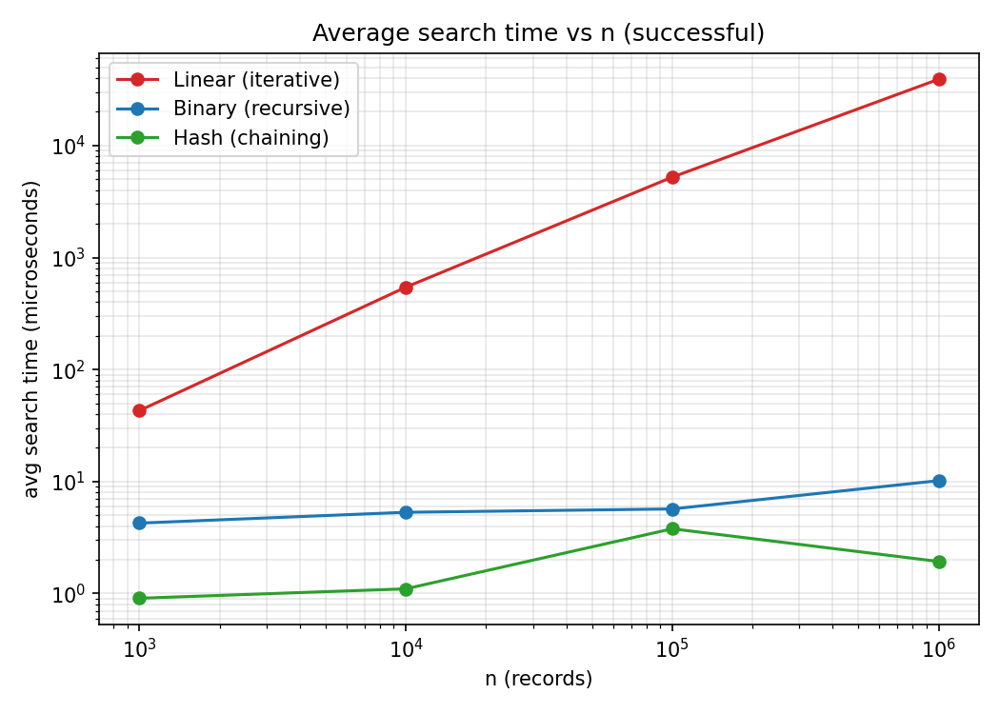
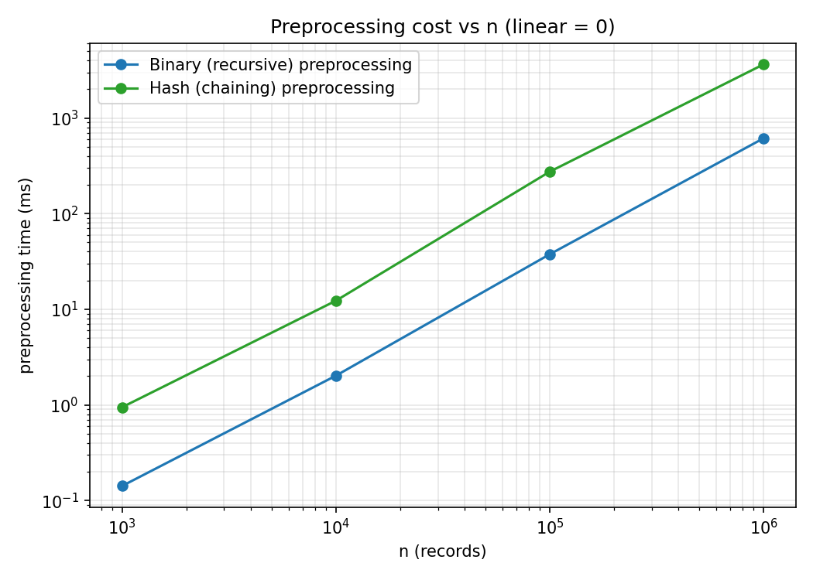
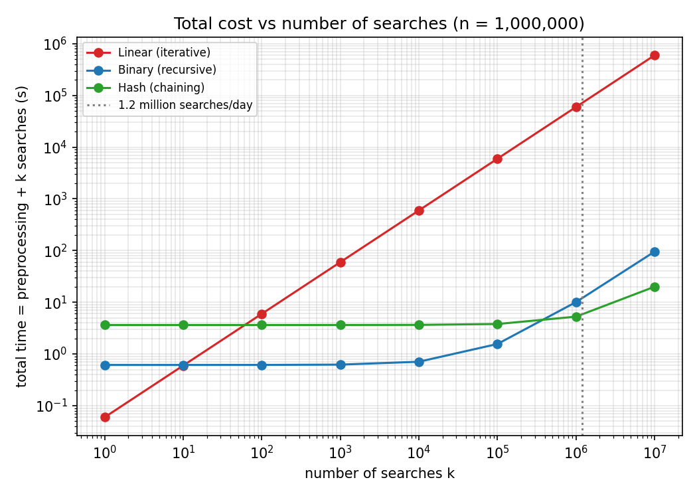

# Task 9 – Record Experimental Performance (3 Marks)

Raw data: `results.csv` / `results.json` (generated by `Source_Code/run_experiments.py`, seed 2024, 100 successful + 100 unsuccessful queries per size, identical for every algorithm).

## Table 1 – Average comparisons, successful search

| n | Linear | Binary | Hash |
|---|---|---|---|
| 1,000 | 440.13 | 9.08 | 1.34 |
| 10,000 | 5,094.63 | 12.34 | 1.45 |
| 100,000 | 49,255.95 | 15.75 | 1.40 |
| 1,000,000 | 480,744.51 | 18.91 | 1.28 |

## Table 2 – Average comparisons, unsuccessful search

| n | Linear | Binary | Hash |
|---|---|---|---|
| 1,000 | 1,000.00 | 9.99 | 0.66 |
| 10,000 | 10,000.00 | 13.37 | 0.84 |
| 100,000 | 100,000.00 | 16.69 | 0.80 |
| 1,000,000 | 1,000,000.00 | 19.94 | 0.71 |

## Table 3 – Worst-case comparisons observed

| n | Linear | Binary | Hash |
|---|---|---|---|
| 1,000 | 1,000 | 10 | 3 |
| 10,000 | 10,000 | 14 | 4 |
| 100,000 | 100,000 | 17 | 4 |
| 1,000,000 | 1,000,000 | 20 | 4 |

## Table 4 – Average search time, successful (µs)

| n | Linear | Binary | Hash |
|---|---|---|---|
| 1,000 | 43.00 | 4.26 | 0.91 |
| 10,000 | 543.57 | 5.32 | 1.10 |
| 100,000 | 5,219.63 | 5.69 | 3.79 |
| 1,000,000 | 39,046.00 | 10.19 | 1.93 |

## Table 5 – Average search time, unsuccessful (µs)

| n | Linear | Binary | Hash |
|---|---|---|---|
| 1,000 | 96.37 | 4.21 | 0.63 |
| 10,000 | 1,027.30 | 6.51 | 0.92 |
| 100,000 | 8,404.71 | 5.16 | 0.93 |
| 1,000,000 | 80,297.60 | 8.73 | 1.33 |

## Table 6 – Preprocessing time (ms)

| n | Linear | Binary | Hash |
|---|---|---|---|
| 1,000 | 0.00 | 0.14 | 0.95 |
| 10,000 | 0.00 | 2.02 | 12.29 |
| 100,000 | 0.00 | 37.59 | 274.40 |
| 1,000,000 | 0.00 | 613.03 | 3,633.09 |

Hash table details: load factor 0.735 / 0.750 / 0.750 / 0.750; longest chain 4 / 6 / 6 / 7 for n = 10³ … 10⁶. All correctness checks: OK.

## Table 7 – Daily update of 1,000 new records at n = 1,000,000

| Method | Time |
|---|---|
| Hash: insert 1,000 records | 1.36 ms |
| Sorted array: merge new records, O(n+k) | 500.7 ms |
| Sorted array: full re-sort | 198.6 ms |

## Graphs

**Reading the graphs (log–log axes).** Linear search is a straight line with slope 1 (Θ(n)); binary search is almost flat (log n); hash is flat (O(1)). The preprocessing curves for sorting and hashing are both a little steeper than slope 1. In Graph 5 (total time for k searches at n = 10⁶) the linear curve starts lowest (no preprocessing) but crosses the binary curve after about 10 searches and the hash curve after about 61 searches; at the Day-4 volume of 1.2 million searches per day the gap is about four orders of magnitude.
